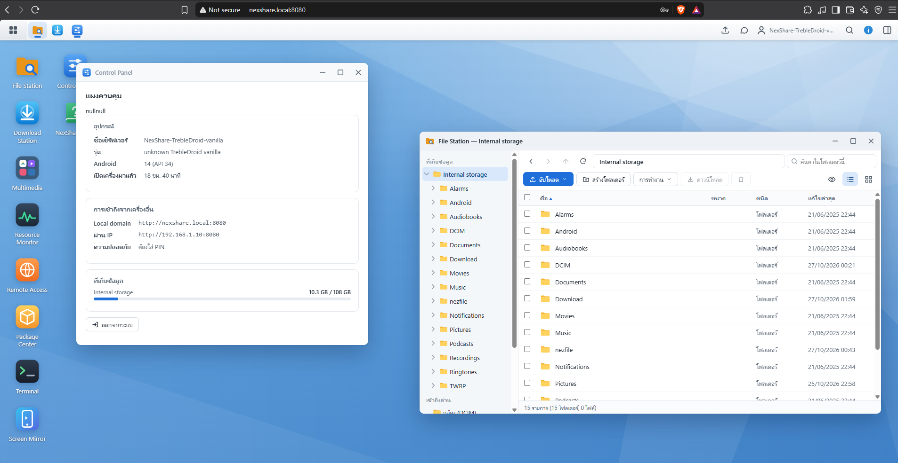
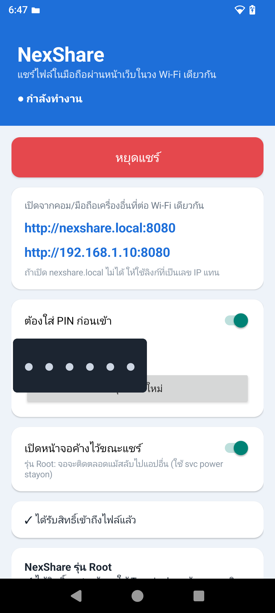

# NexShare

**English** · [ภาษาไทย](README.th.md)

Turn your Android phone into a tiny NAS. NexShare runs a web server on the phone
and serves a Synology-DSM-style desktop you open from any device on the same
Wi-Fi at **http://nexshare.local:8080** (or the phone's IP). Browse, upload,
download, stream and manage the phone's files from a browser.

Built with plain Java and a hand-written HTTP server — no Gradle, no AndroidX.

## Screenshots

The web desktop, open in a browser on another device:



The Android app (Root edition):



*(running on real hardware; the access PIN is redacted)*

## Two editions

| | **NexShare** (normal) | **NexShare Root** |
|---|---|---|
| Package id | `com.nexshare` | `com.nexshare.root` |
| File Station, Media Player, Download Station, Wallpaper | ✓ | ✓ |
| Install APKs from the web UI | prompts on the phone | **silent** (`pm install`) |
| Terminal (root shell, bundled BusyBox ~300 tools, uses Termux packages too) | — | ✓ |
| Live screen mirror + remote tap/swipe/keys | — | ✓ |
| Keep screen on across the whole device | foreground only | `svc power stayon` |
| App manager (disable/uninstall/force-stop/clear) | open only | full |

Both are signed with the same key and have different package ids, so you can
install them side by side. The Root edition needs Magisk/SuperSU and a granted
root prompt.

## Features

- **File Station** — DSM-style windowed file browser: list/grid views, drag-and-drop
  upload (files and whole folders), multi-select, download (multiple files zip on the
  fly), copy/move/rename/delete, search, image/video thumbnails, breadcrumb nav.
- **Media Player** — playlists, resume where you left off, auto-loads matching
  `.srt`/`.vtt` subtitles, playback speed, loop/shuffle, PiP, YouTube-style
  keyboard shortcuts, and a "open in VLC" fallback for codecs the browser can't play.
- **Download Station** — download from http/https links or BitTorrent
  (magnet links and `.torrent` files, via libtorrent4j) straight to the phone,
  with pause/resume, progress, speed and peers.
- **Remote Access (Cloudflare Tunnel)** — expose the server on the internet with one
  tap. Get a throwaway `https://<name>.trycloudflare.com` URL, or paste a named-tunnel
  token to bind your own domain. `cloudflared` is bundled (arm64 + arm), so no Termux
  needed. Enabling a tunnel force-enables the PIN.
- **Wallpaper** — generate NexOS-branded wallpapers and set them on the phone,
  or set any image in File Station as wallpaper.
- **System widgets** — System Health, Resource Monitor (CPU/RAM/network),
  Storage, battery.
- Reachable at `nexshare.local` via a built-in mDNS responder, with IP fallback.
  Optional 6-digit PIN login.
- **Share links** — send a file or folder to anyone with a link (`/s/<id>`), with expiry,
  optional password, QR code and download counter. Works on the LAN and through the tunnel.
- **Recycle Bin** — deletes go to a per-volume trash and can be restored; auto-purged after
  30 days (configurable). Shift+Delete deletes permanently.
- **WebDAV** at `/dav/` — map the phone as a network drive in Windows Explorer, macOS Finder,
  Linux file managers, VLC, Infuse… (read/write, with the lock emulation Windows/macOS need).
- **Multiple users** — accounts with roles (read-only / read-write / admin), optionally limited
  to specific folders. Applies to the web UI, WebDAV and share links.
- **Backup Station** — back up a folder from your computer to the phone; only new or changed
  files are sent. Chrome/Edge over HTTPS remember the folder for one-click re-runs.
- **Installable web app (PWA)** when opened over HTTPS.
- **Screen Mirror (root)** streams H.264 from `screenrecord` over a WebSocket and decodes it with
  WebCodecs — much smoother than screenshots (falls back to screenshots when unsupported).

## Security

- **Admin password** can replace the 6-digit PIN; **2FA (TOTP)** can be required always or
  only for logins through the internet tunnel.
- **Brute-force protection**: 5 failures lock the client with exponential backoff
  (1 min → 64 min). Behind the tunnel the real client IP comes from `CF-Connecting-IP`
  (trusted only from the local cloudflared), and all tunnel failures also share a global budget.
- **Sessions** survive app restarts; only SHA-256 hashes of tokens are stored. Changing the PIN or
  password, or removing a user, ends their sessions.
- **Sudo**: the root terminal, screen control, app installs and security settings ask you to
  re-enter your PIN/password (valid 10 minutes).
- **HTTPS** on port 8443 with a self-signed certificate generated on the phone (download it from
  Control Panel to trust it); optional redirect of HTTP → HTTPS. API calls are checked against
  `Origin` (CSRF), cookies are `HttpOnly; SameSite=Strict`, and phone-hosted HTML/SVG is served
  sandboxed so it can't act as the logged-in user.
- **Recovery**: the phone app can clear the admin password, turn 2FA off, unlock lockouts and log
  out every browser.

## Download

Grab the APK for your edition from the [Releases](../../releases) page:

- `NexShare-vX.Y.Z.apk` — normal edition
- `NexShare-Root-vX.Y.Z.apk` — root edition

Enable "install from unknown sources", install, open the app, grant
**All files access**, and the server starts. Open the shown URL from another
device on the same Wi-Fi.

## Build from source

### Linux / macOS / CI

```bash
./setup.sh           # one-time: Android SDK pieces + libtorrent4j + cloudflared + busybox (needs JDK 17+)
./build.sh           # both editions into dist/   (./build.sh root|normal for one)
./test/run-tests.sh  # JVM tests: HTTP server, crypto/TLS, auth, users, trash, share links, WebDAV
python test/ui/ui_test.py   # browser smoke tests (needs `pip install playwright`)
```

GitHub Actions (`.github/workflows/build.yml`) runs the tests and builds both APKs on every push;
tags `v*` attach the APKs to a release. Set the `NEXSHARE_KEYSTORE_B64` and
`NEXSHARE_KEYSTORE_PASS` secrets so releases are signed with your existing key (otherwise phones
can't update over the old install).

### Windows

No Android Studio needed — the scripts fetch a private JDK + Android SDK into
`.tools/` and the libtorrent4j jars into `libs/`.

```powershell
./setup.ps1          # one-time: downloads JDK 17 + Android SDK + libtorrent4j + cloudflared (~620 MB)
./build.ps1          # builds both editions into dist/
./build.ps1 -Flavor root     # or just one edition: normal | root
```

Output: `dist/NexShare-v<version>.apk` and `dist/NexShare-Root-v<version>.apk`.

The build runs `aapt2 → javac → d8 → zipalign → apksigner` directly. A signing
keystore is generated on first build and kept in `.tools/` (git-ignored).

## Project layout

```
app/AndroidManifest.xml      app manifest (package/label rewritten per edition at build time)
app/src/com/nexshare/
  HttpServer.java            HTTP/1.1 server: keep-alive, chunked bodies, TLS, WebSocket
  WebApi.java                router: HTTPS redirect, CSRF check, login/role/sudo gating
  Auth, Users, SessionStore  login, rate limiting, 2FA, accounts and sessions
  FileApi, Trash, Shares     File Station API, recycle bin, public share links
  WebDav.java                WebDAV server at /dav/
  SystemApi.java             stats, Control Panel settings, users, tunnel, downloads
  RootApi.java               root edition: terminal, screen stream, app manager
  CertGen, TlsManager        self-signed certificate + HTTPS listener
  Storage, Crypto, Zip       path safety, file streaming, hashing/TOTP/encodings
app/assets/web/              the web desktop: index.html, style.css, js/*.js, sw.js, manifest
app/res/                     launcher icon
test/                        JVM unit + integration tests (with Android fakes), browser UI tests
build.sh / setup.sh          Gradle-less build + toolchain bootstrap (Linux/macOS/CI)
build.ps1 / setup.ps1        the same for Windows
libs/                        libtorrent4j jars + cloudflared + busybox (fetched by setup)
```

## WebDAV quick start

Address: `http://nexshare.local:8080/dav/` (or `https://<phone-ip>:8443/dav/`). Log in as
`admin` with the PIN/admin password, or with a user account.

- **Windows**: File Explorer → This PC → *Map network drive*. Windows only sends passwords over
  plain `http://` if `BasicAuthLevel` is set to 2 in the registry, so prefer the `https://` address
  (after installing the certificate from Control Panel).
- **macOS**: Finder → Go → *Connect to Server…* (⌘K).
- **Linux**: `dav://…` or `davs://…` in your file manager.

WebDAV over the internet is off by default (Control Panel → Services); it uses Basic auth and
can't ask for a 2FA code.

## Notes & safety

- `usesCleartextTraffic` is on because the server also speaks plain HTTP on the LAN; on
  untrusted networks keep login on and use HTTPS (Control Panel → Security → Force HTTPS). Routers with AP/client isolation block
  device-to-device access.
- The Root edition executes shell commands as uid 0 at your request. The terminal,
  app manager and installer act on the device with full privileges — use them as
  carefully as any root tool.
